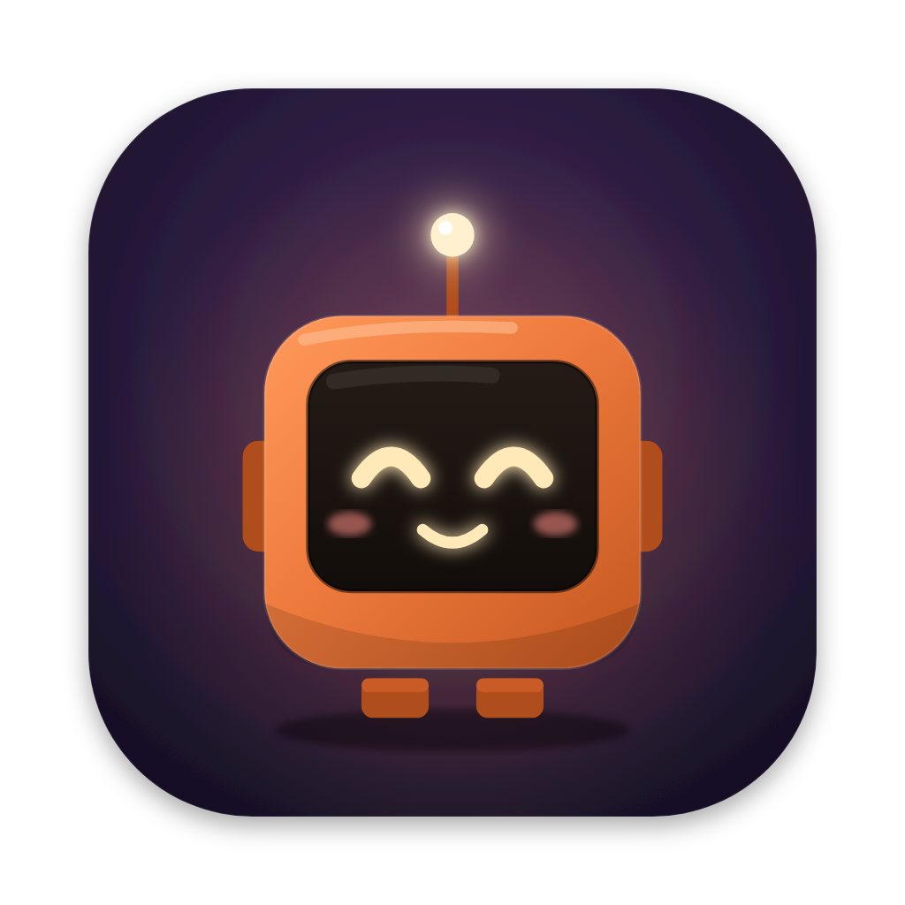
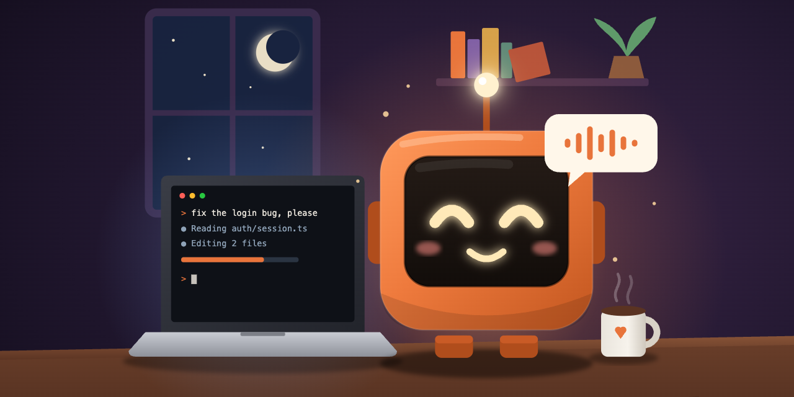
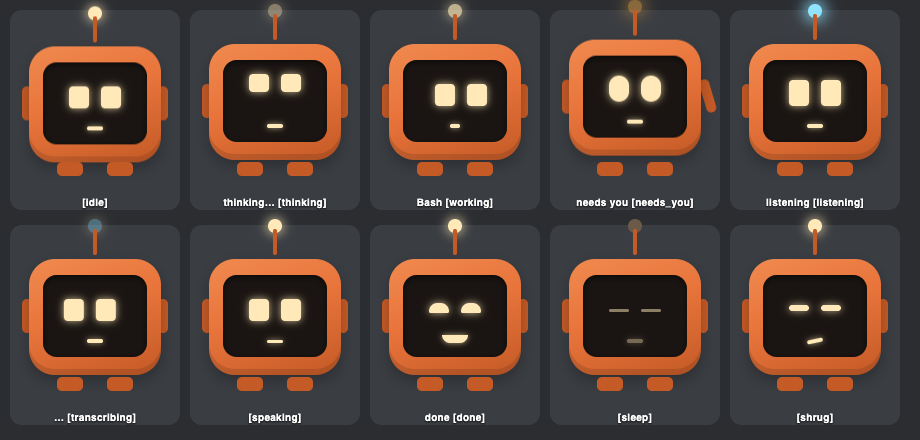
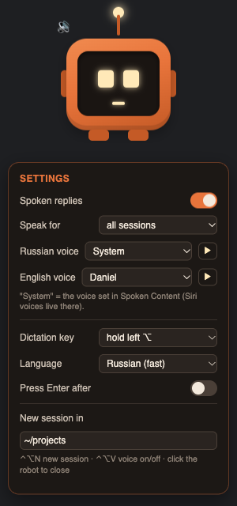

#  Desk Mascot



A small robot that sits on your Mac screen and keeps you company while [Claude Code](https://claude.com/claude-code)
works. Hold a key and talk to your session, watch the robot think, work and wave when Claude needs you, and hear a
short spoken answer when it's done.

Unofficial, not affiliated with Anthropic. Everything runs locally. No API key needed: it drives the normal `claude` CLI
you already use.



## What it does

- **Talk to Claude:** hold **left ⌥ Option** and speak, then release. Speech is transcribed on your Mac by
  [whisper.cpp](https://github.com/ggml-org/whisper.cpp) and pasted into the active window, usually in about a second.
- **New session:** **⌃⌥N** opens a new terminal tab running `claude` (Warp if you have it, otherwise Terminal).
- **The robot reacts** to Claude Code hooks: thinking, working (with the tool name), *needs you* (permission prompts),
  done. With several sessions it shows the one that matters most, plus a counter.
- **Spoken replies:** the first sentence or two of Claude's answer, read by a macOS voice. **⌃⌥V** turns them on and off.
- **Settings:** click the robot. Drag it to move it.



## Requirements

- macOS on Apple Silicon (Intel is untested)
- [Homebrew](https://brew.sh)
- [Claude Code](https://claude.com/claude-code) CLI
- About 700 MB of disk for the speech model and dependencies

## Install

```bash
git clone https://github.com/olevasyliev/desk-mascot ~/desk-mascot
cd ~/desk-mascot
./install.sh
```

The installer adds whisper.cpp and Python 3.12 through Homebrew, sets up a local Python environment, downloads the
speech model (~550 MB; `MODEL=small ./install.sh` gets a ~190 MB one), adds the Claude Code hooks, and puts a small
**Desk Mascot** app into your login items so the robot starts with your Mac.

### Permissions (once)

macOS asks for the **microphone** the first time you dictate. You also need to allow two things in
**System Settings → Privacy & Security**:

- **Accessibility**: lets the mascot paste the text it heard (⌘V). It may be listed as **applet**.
- **Input Monitoring**: lets it see the dictation and shortcut keys.

Restart the mascot afterwards (log out and in, or run `./install.sh` again). If the hotkeys don't work, see
[Troubleshooting](#troubleshooting).

## Settings

Click the robot to open settings. Changes apply right away and are saved to `settings.json`.

| Setting | Options |
|---|---|
| Spoken replies | on / off |
| Speak for | all sessions, or only the session you prompted last |
| Russian / English voice | any installed macOS voice, or **System**: the voice chosen in *Accessibility → Spoken Content*. That's the only way to use Siri voices. |
| Dictation key | hold left or right ⌥ |
| Language | auto-detect or one of 10 languages (a fixed one is ~2x faster). Add more in `config.toml` → `stt.languages` |
| Press Enter after | send the prompt right after pasting |
| New session in | folder for new sessions |
| Show in Dock | robot icon in the Dock, or no Dock icon at all (the robot stays on screen) |

Everything else (shortcuts, model, port) is in `config.toml`. Values in `settings.json` override it.

Using a macro pad? Map its keys to **F18** (new session), **F19** (hold to talk) and **F17** (voice on/off).

## How it works

```
Claude Code hooks ──POST──▶ mascotd (127.0.0.1:7788) ──WebSocket──▶ robot window
hotkeys ───────────────────▶   │  whisper.cpp server (local STT)
                               │  macOS `say` (spoken replies)
```

- `hooks/mascot-hook.sh` forwards each hook event with a 0.3 s timeout and always exits 0. If the mascot isn't running,
  Claude Code doesn't notice.
- The hooks are merged into `~/.claude/settings.json` next to your existing ones, and a backup is saved first.
- Nothing leaves your Mac. The log at `~/Library/Logs/desk-mascot.log` contains what you dictated.
- The local API (`/event`, `/action/*`, `/ws`) is meant for a future hardware version: an ESP32 robot with a screen and
  real buttons.

## Uninstall

```bash
./uninstall.sh
```

This removes only the mascot's hooks, the login item and the app. To remove everything else, delete the folder.

## Troubleshooting

- **Hotkeys do nothing, or text isn't pasted.** Check that Accessibility and Input Monitoring are on for
  **Desk Mascot** / **applet**, then restart the mascot. On startup the log says `accessibility: yes` or `NO`.
  Without Accessibility, the text stays on the clipboard and the robot shows *copied · ⌘V*.
- **No voice.** Check the output device and volume, then press ▶ next to a voice in settings.
- **⌥ is used for something else.** Holding ⌥ with another key (⌥←, ⌥-letter) never counts as dictation. You can also
  move dictation to the right ⌥ in settings.

## License

MIT
